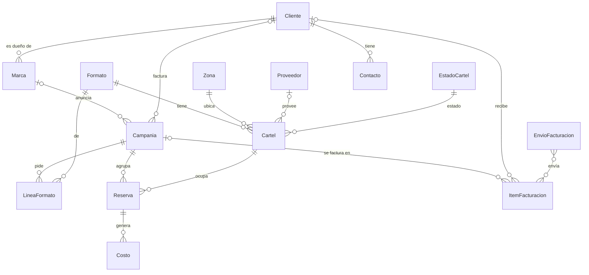
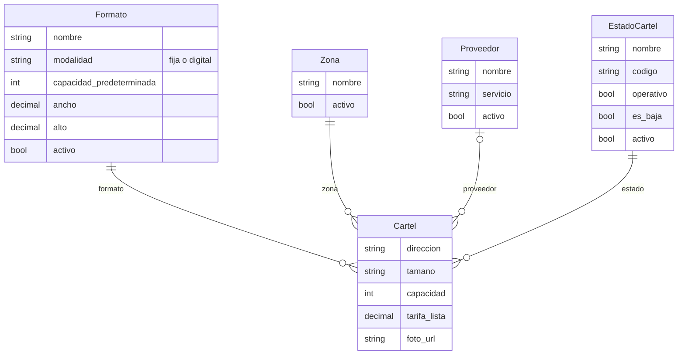
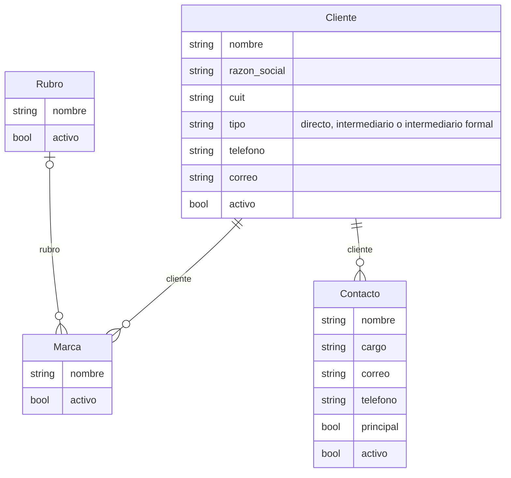
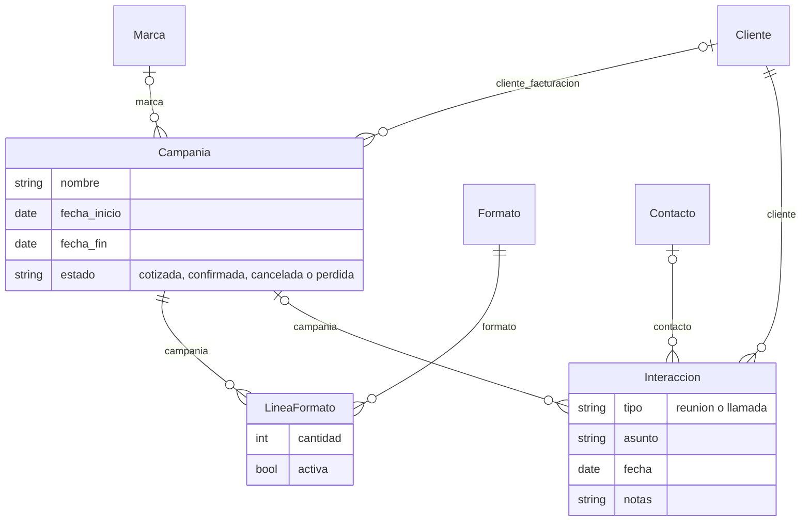
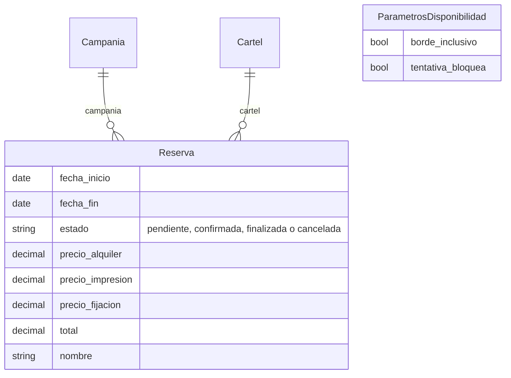
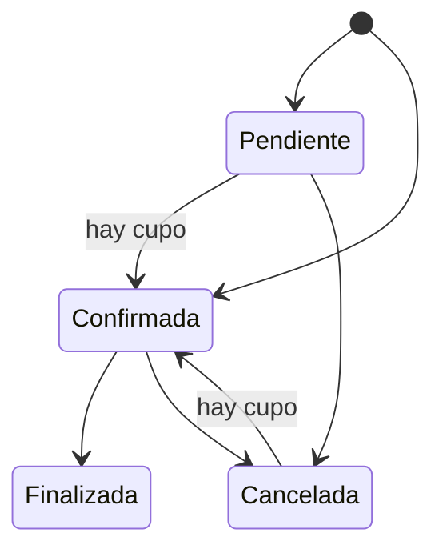
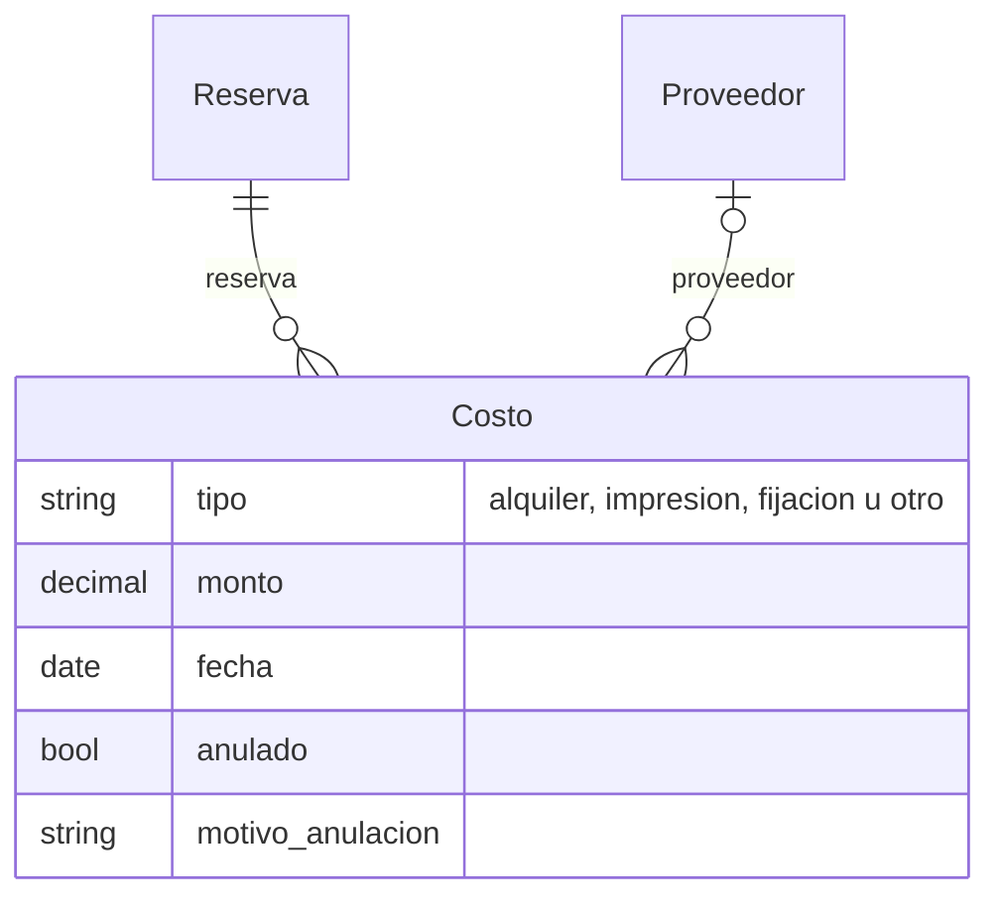
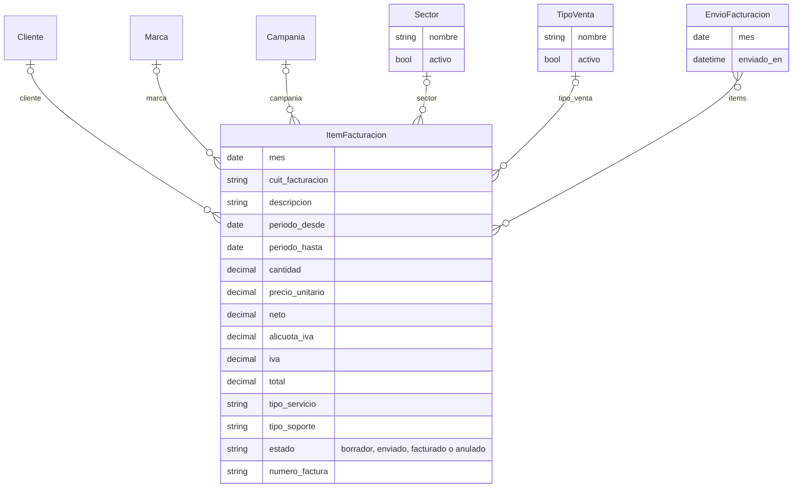
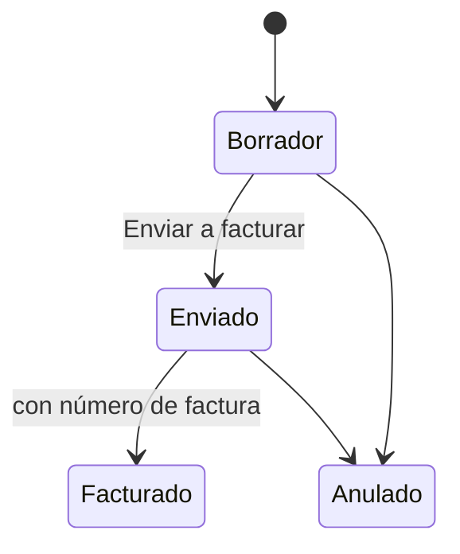
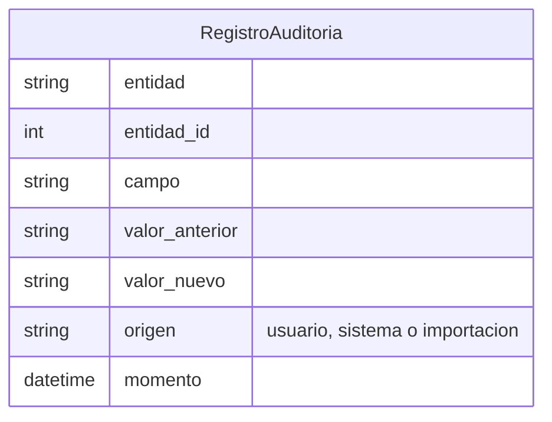

# Modelo de datos

Qué guarda cada app y cómo se relaciona. Cada sección tiene un diagrama entidad-relación (GitHub lo
dibuja) y una tabla por modelo con sus campos clave y sus reglas. La fuente de verdad son los
modelos en `backend/apps/<app>/models.py`; este documento se actualiza cuando cambian.

Convenciones que valen para todas las apps:

- **Nada se borra desde la API** (baja lógica): los registros se inactivan (`activo`/`activa`), se
  dan de baja por estado o se anulan. Las claves foráneas usan `PROTECT`, así que la base tampoco
  deja borrar algo que está en uso.
- **Dinero en `Decimal`**, con dos decimales (regla 5 de [`CLAUDE.md`](../CLAUDE.md)).
- **Fechas con zona horaria**: `creado_en` y `actualizado_en` se completan solos.
- **Búsqueda sin tildes**: los campos `*_busqueda` guardan una copia normalizada del texto (sin
  tildes ni mayúsculas) y se calculan al guardar; no se editan.
- **Nombres de catálogo únicos sin distinguir mayúsculas**: no puede haber "LED" y "led".
- **Cambios auditados**: los servicios registran en `auditoria` cada campo que cambia.
- Los usuarios son el `User` estándar de Django; el rol sale de sus grupos (ver
  [`usuarios`](#usuarios)).

Las dependencias entre apps siguen la tabla de [`CLAUDE.md`](../CLAUDE.md#2-arquitectura-y-estructura).
En los diagramas, una entidad de otra app aparece con su nombre y sin campos.

## Mapa general

## `usuarios`

| Modelo | Para qué | Campos clave | Reglas |
| --- | --- | --- | --- |
| `IntentoIngreso` | Cuenta los ingresos fallidos seguidos de un nombre de usuario (exista o no) | `username` (único), `fallidos_seguidos`, `bloqueado_hasta` | Bloqueo tras `DJANGO_LOGIN_MAX_INTENTOS` fallidos durante `DJANGO_LOGIN_BLOQUEO_MINUTOS` (HU-003) |

Los roles no son un modelo: se derivan de Django en cada pedido.

| Rol | Cómo se obtiene | Qué puede |
| --- | --- | --- |
| Administrador | Superusuario | Todo, incluidos usuarios y parámetros |
| Operativo | Grupo **Operativo** | Cargar y editar inventario, clientes, campañas, reservas y facturación |
| Lectura | Ningún grupo de rol, o grupo **Lectura** | Consultar |
| Gerencia (permiso) | Grupo **Gerencia**, sumado a cualquier rol | Ver ingresos y auditoría |

## `inventario`

| Modelo | Para qué | Campos clave | Reglas |
| --- | --- | --- | --- |
| `Formato` | Tipo de soporte (LED, Séxtuples, Carteleras…) | `modalidad` (fija o digital), `capacidad_predeterminada` ≥ 1, medidas opcionales | La migración crea los siete formatos. Capacidad editable por cartel (RN-004, RN-005) |
| `Zona` | Departamento de Mendoza | `nombre` | Los nueve departamentos de RN-008, creados por migración |
| `Proveedor` | Quien provee o mantiene el cartel | `nombre`, `servicio` | Opcional en el cartel |
| `EstadoCartel` | Estado físico | `codigo` (se genera del nombre), `operativo`, `es_baja` | Un cartel en un estado `es_baja` está dado de baja y no se reserva (RN-010) |
| `Cartel` | Un espacio publicitario | `formato`, `zona`, `estado`, `direccion`, `capacidad` ≥ 1, `tarifa_lista` ≥ 0 o vacía | La capacidad es la cantidad de reservas simultáneas (cupos o slots). El nombre visible suma "· N slots" en los séxtuples o el tamaño |

## `clientes`

| Modelo | Para qué | Campos clave | Reglas |
| --- | --- | --- | --- |
| `Cliente` | A quién se le factura | `nombre`, `razon_social`, `cuit`, `tipo` | Todo es opcional. El CUIT se valida (dígito verificador) y es único si está cargado. Sin nombre se muestra "Cliente sin nombre #id" |
| `Marca` | Marca que se anuncia, de un cliente | `cliente`, `rubro` (opcional) | Una campaña sin cliente propio factura al cliente de su marca (RN-014) |
| `Rubro` | Categoría de la marca, para reportes | `nombre` | Nombre único |
| `Contacto` | Persona de un intermediario formal | `cliente`, `principal` | Solo en clientes intermediario formal (RN-015). Un solo principal por cliente, y tiene que estar activo |

## `campanias`

| Modelo | Para qué | Campos clave | Reglas |
| --- | --- | --- | --- |
| `Campania` | El contenedor comercial de un cliente y una marca | `marca`, `cliente_facturacion`, fechas, `estado` | Todo opcional mientras está Cotizada. Para confirmarla se exigen marca, cliente que factura y ambas fechas (RN-011). Quién factura: `cliente_facturacion` si está; si no, el cliente de la marca (RN-014) |
| `LineaFormato` | Cuántas posiciones de un formato pide la campaña (HU-055) | `formato`, `cantidad` (opcional) | Un formato no se repite entre las líneas activas. Cambiarla o quitarla no toca las reservas. Quitar es `activa=False` |
| `Interaccion` | Reunión o llamada con un cliente (HU-020) | `tipo`, `fecha`, `cliente`, `contacto` y `campania` opcionales, `registrada_por` | El contacto tiene que ser del mismo cliente y estar activo. Vive acá y no en `clientes` porque puede llevar campaña |

## `reservas`

| Modelo | Para qué | Campos clave | Reglas |
| --- | --- | --- | --- |
| `Reserva` | Un cupo de un cartel para una campaña en un rango de fechas | `campania`, `cartel`, fechas, `estado`, precios | `total` = alquiler + impresión + fijación, se calcula al guardar. `nombre` se genera: "Marca - Cartel - Mes Año" (HU-030). Fin ≥ inicio y precios ≥ 0. Nace Pendiente o Confirmada. Ocupan cupo todas menos las Canceladas; el bloqueo duro se valida al confirmar, en una transacción con el cartel bloqueado (regla 7, HU-031, HU-034) |
| `ParametrosDisponibilidad` | Parámetros del motor de disponibilidad que cambia el administrador | `borde_inclusivo` (RN-001), `tentativa_bloquea` (RN-002) | Una sola fila (`pk=1`), creada por migración; no se borra |

Estados de una reserva:

Cómo se cuentan los cupos: ocupación máxima de cualquier día del rango (pico diario, RN-003). El
día en que termina una reserva y empieza otra se pisa mientras RN-001 sea inclusiva.

## `costos`

| Modelo | Para qué | Campos clave | Reglas |
| --- | --- | --- | --- |
| `Costo` | Lo que cuesta una reserva (proveedor, impresión, fijación) | `reserva`, `tipo`, `monto` > 0, `fecha` | No se borra: se anula con motivo. El margen de la campaña es ingreso menos costos no anulados (RN-007) |

## `facturacion`

| Modelo | Para qué | Campos clave | Reglas |
| --- | --- | --- | --- |
| `ItemFacturacion` | Un renglón a facturar en el mes (HU-060) | `mes` (siempre el día 1), `cliente`, `neto`, `alicuota_iva` (21 % por defecto, RN-023), `estado`, `numero_factura`, `creado_por` | Nada es obligatorio mientras está en Borrador. `iva` y `total` se calculan siempre desde el neto y la alícuota, redondeados al centavo (HU-061). Solo se editan los datos en Borrador. Facturado exige número de factura. No se borra: se anula (HU-065) |
| `Sector` | Lista Gob/Priv | `nombre` | Administrable desde el admin (RN-023) |
| `TipoVenta` | Lista F/V | `nombre` | Administrable desde el admin (RN-023) |
| `EnvioFacturacion` | Un "Enviar a facturar" de un mes: quién, cuándo y qué ítems (HU-066) | `mes`, `enviado_por`, `enviado_en`, `items` | Solo se envían los Borradores completos (cliente, neto y mes); los incompletos quedan en Borrador (RN-025). No se edita ni se borra. De cada envío sale la planilla .xlsx para Administración (RN-024) |

Estados de un ítem a facturar:

Corregir un ítem Facturado espera la definición de RN-026.

## `auditoria`

| Modelo | Para qué | Campos clave | Reglas |
| --- | --- | --- | --- |
| `RegistroAuditoria` | Un campo que cambió en cualquier entidad | `entidad` + `entidad_id`, `campo`, valores anterior y nuevo, `usuario`, `origen`, `momento` | Inmutable: el modelo rechaza editar y borrar. Las demás apps escriben solo por su servicio, sin importar el modelo |
